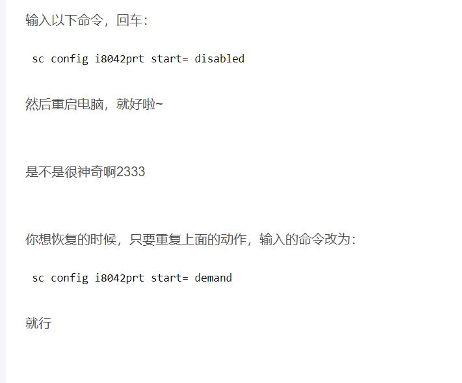
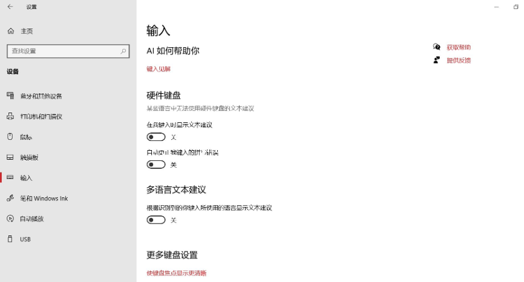

## 写在前面

**一旦发现作弊，其队伍所在学校的所有队伍均取消比赛成绩，并将情况向所有中国区赛站通报！**

## 洗手间相关

拍一圈证明洗手间没有人。

Q：请问学生上洗手间，是自己在手机小程序申请，还是志愿者在……（省略）     
A：应该是学生自己申请，没事志愿者不能在赛场里，除非有事喊他进来。

Q：选手申请上洗手间，然后监考老师在微信群喊教练进入赛场？    
A：对，喊人进腾讯会议，全程跟拍。

## 查验身份相关

根据以前的经验，有一种偷懒的办法是先拿手机对着二维码拍照，等那个提交按键亮起之后再拿远一点拍三位队员和证件就可以，后面好像不需要管二维码什么事。

## 比赛设备相关

我们自测的时候发现wsl会打开远程桌面进程而被oms拦截，虽然可以用任务管理器杀掉但是保不准什么时候会出岔子。

Q：如果用笔记本比赛的话能用外接键盘吗？      
A：可以，但是全程保证只有一个键盘是启动的。     
如果被检测到两个键盘在启用中，那主考就准备动刀了……

Q：可以中途换键盘吗？     
A：不可以，动USB接口就死。

Q：笔记本接usb鼠标应该可以吧？     
A：可以，触摸板禁掉。

禁用键盘？
 
 

 

## 监考相关

Q：如果是一个人参赛，如果过程中出现了问题怎么联系到呢？……（省略）    
A：手机监控上有一个紧急求助的按钮，按了以后监考会看到，会来联系他。

**所以队员得留意弹窗，手机音量调大。**

Q：请问前置摄像头需要同时拍到三位参赛同学吗？……（省略）     
A：一般拍不全，只能说前面或者后面，总有一个能拍到3人就行，目的是不要有一个人跑出去了监考不知道。如果监考看不全3个人了，可能会喊人，让把手机拿起来拍一下周围。

Q：关于题目的疑问，我看ppt里是使用小程序求助，就是说队员转身，在后面的手机上打开小程序求助吗？但是pdf文件里说的是，和现场老师说，老师在群里问？     
A：都可以。

Q：在家里比赛的学生也需要加入腾讯会议吗？      
A：那肯定不能，比赛中队员打开腾讯会议立刻被踢下线了。

**多准备几个充电宝，保证手机电量够用。**

Q：教练在赛场，有事再喊志愿者进来？      
A：教练跟志愿者一样，都不能在赛场里。

大家保障供电正常、网络正常、手机电池带够，应该全程没什么事。

Q：微信小程序的摄像头，侧边或者后面，都能对着3个人，是否都可？     
A：后面的镜头应该拍到3个人的背影动作。任何时候监考觉得不安，有权要求队员调整机位让老师看清楚。

Q：教练进入腾讯会议，也需要让整个赛场情况在会议里呈现出来吗？       
A：不需要。除非监考要求看一下有没有违规投影在机房里。

Q：如果后机位手机没电或者过热关机，重新换一台手机的话，是需要重新登录等待审核吗？      
A：不需要，打开屏幕右下角的二维码，扫码重连就可以了。

Q：请问IDE上有代码模板，可以吗？是不是也算作弊？      
A：当然算作弊。

## 杂（le）项（zi）

Q：能语音输入代替键盘吗？       
A：不能。你打算朗读代码让全校跟着敲吗？
